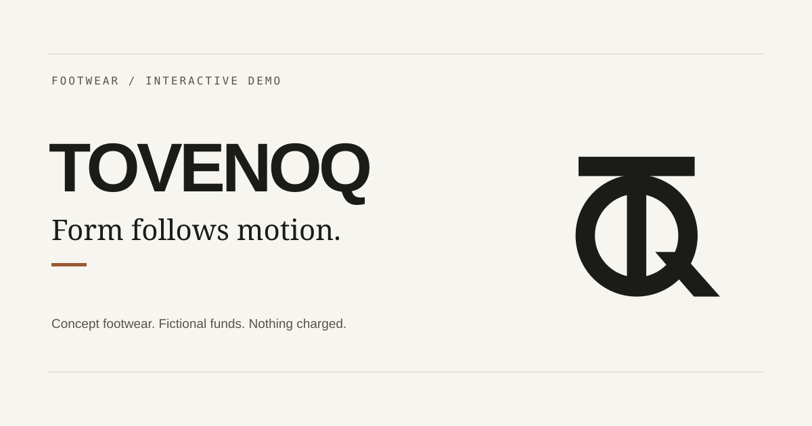

# TOVENOQ Footwear

An editorial footwear storefront built as a self-contained commerce demo.



TOVENOQ presents four fictional footwear styles through a responsive product
catalogue, detailed image galleries, saved items, a shopping bag and a complete
demo checkout journey. Visitors can add fictional funds, place an order, view a
receipt and advance its tracking status without connecting to a payment
provider or backend.

> **Demo only:** no real money is accepted, no products are shipped, and no
> customer account or personal information is collected.

## Features

- Four footwear styles across five displayed colourways.
- Multi-view product galleries with side, front, rear, top, detail and on-foot
  imagery.
- Collection filters for new arrivals, men and women.
- Search by style, description or colourway.
- Saved styles and a persistent shopping bag.
- A browser-local demo wallet with preset and custom funding amounts.
- Simulated checkout, order receipts and a four-stage tracking timeline.
- Printable demo receipts.
- Responsive layouts for phone, tablet and desktop screens.
- Keyboard-operable dialogs, focus management and reduced-motion support.
- Page-specific metadata, favicons, manifest icons and a social sharing card.
- Static output suitable for Git-connected hosting on Netlify.

## Demo boundaries

This project is deliberately frontend-only. Its commerce features are a local
simulation, not a sandbox connected to a real commerce provider.

It does **not** include:

- authentication or user accounts;
- a server API or database;
- payment processing;
- inventory management;
- tax, shipping or fulfilment calculations;
- delivery-address, email or card collection;
- real order confirmation or parcel tracking.

Bag contents, saved styles, demo funds and orders are stored in the browser's
`localStorage`. Data is tied to that browser profile and site origin. It will
not follow a visitor to another device or browser, and moving from localhost to
a deployed domain starts a separate local data set.

## Technology

- React 19 and TypeScript
- vinext on Vite 8
- Static export via `output: "export"`
- Plain CSS for layout, responsive behavior and motion
- Node's built-in test runner
- ESLint with React, hooks, accessibility and Next.js rules
- GitHub Actions for continuous integration
- Netlify configuration for Git-based deployment

There is no component library, animation package, database SDK or payment SDK.

## Getting started

### Requirements

- Node.js `22.13.0` or newer
- npm

Node.js 24 is used by CI and the Netlify build configuration.

### Install and run

```bash
npm ci
npm run dev
```

The development server listens on port `4177` and prints both localhost and
local-network addresses. Open `http://localhost:4177` on the development
machine. The local-network URL can be used to test another device on the same
network.

### Production build

```bash
npm run build
```

The static site is written to `dist/client`.

## Commands

| Command | Purpose |
| --- | --- |
| `npm run dev` | Start the vinext development server on `0.0.0.0:4177`. |
| `npm run build` | Create the static production export. |
| `npm test` | Build the export, then run every test in `tests/`. |
| `npm run lint` | Run the repository ESLint configuration. |
| `npx --no-install tsc --noEmit` | Type-check without writing build files. |

Generated directories such as `dist`, `.next`, `.vinext` and `.wrangler` are
ignored by Git and can be recreated. `node_modules` can be restored with
`npm ci`.

## Main routes

| Route | Description |
| --- | --- |
| `/` | Editorial landing page and collection introduction. |
| `/shop` | Full collection and category filters. |
| `/products/axis-01` | Axis 01, including both colourways. |
| `/products/frame-02` | Frame 02 product page. |
| `/products/field-03` | Field 03 product page. |
| `/products/line-04` | Line 04 product page. |
| `/saved` | Styles saved in the current browser. |
| `/account` | Fictional balance and funding controls. |
| `/checkout` | Simulated purchase review and order placement. |
| `/orders` | Local receipts and simulated tracking. |
| `/about` | Brand story and design principles. |
| `/help` | Sizing, care, delivery and common questions. |
| `/policies` | Plain-language demo status, privacy and terms. |

Collection filters also work as static URLs, including
`/shop?category=new`, `/shop?category=men` and `/shop?category=women`.

## How the local commerce demo works

The catalogue in `lib/catalog.ts` is the source for products, colourways,
prices, sizes and gallery images. `components/store-provider.tsx` manages the
shopping state and persists it under three versioned keys:

- `tovenoq-cart-v1`
- `tovenoq-wishlist-v1`
- `tovenoq-demo-account-v1`

`lib/demo-commerce.ts` contains the funding, checkout, receipt and tracking
rules. Stored account data is validated before it is displayed. Purchases
cannot overdraw the fictional balance, and malformed local data is discarded
instead of trusted.

Funding is limited to $100,000 per action and a $1,000,000 maximum balance.
These values are only integer cents in local browser storage. Demo references
are not credentials and work on local-network HTTP pages as well as secure
deployed origins.

To reset the experience, clear this site's browser storage. That removes the
local bag, saved styles, balance and order history for that origin.

## Project structure

```text
app/                 Pages, metadata and global styles
components/          Storefront UI and browser-local state provider
lib/                 Catalogue, demo-commerce rules, IDs and metadata helpers
public/images/       Product and editorial imagery
public/brand/        Favicons, app icons, logo exports and social card
scripts/             Optional brand-asset export tooling
tests/               Commerce, search, metadata, asset and export checks
.github/workflows/   GitHub Actions CI
docs/                Retrospective plan, decisions, QA and handover records
```

## Environment variables

The application runs locally without environment variables.

`SITE_URL` is optional and should be set at build time after a public HTTPS
origin exists:

```text
SITE_URL=https://example.com
```

When set, it enables absolute canonical URLs, `og:url` and the absolute social
sharing image URL. The value must be a public HTTPS origin with no credentials,
path, query string or fragment. Do not invent a placeholder production URL.

Google Fonts are requested from Google's font CDN. Local system fallbacks are
defined for environments where the external font request is unavailable.

## Testing and quality checks

`npm test` first creates a real static export, then checks:

- fictional funding, balance and purchase calculations;
- receipt snapshots and tracking progression;
- rejection of malformed stored account data;
- compatibility when `crypto.randomUUID()` is unavailable;
- catalogue image coverage and local file presence;
- search behavior across products and colourways;
- branding assets, manifest entries and sharing metadata;
- expected content across the exported routes.

The latest local production check prerendered the storefront routes and passed
all 15 automated tests. TypeScript passes. ESLint has no application errors;
it reports 12 existing `no-img-element` performance warnings for deliberate
local catalogue imagery.

Local browser QA covered the public pages at phone, tablet and desktop widths,
keyboard navigation, dialogs, product galleries and the complete fictional
purchase journey. This is useful project evidence, not formal accessibility or
cross-browser certification. See [local QA](docs/local-qa.md) for the recorded
matrix and remaining manual checks.

## CI and deployment

### GitHub Actions

`.github/workflows/ci.yml` runs on pushes, pull requests and manual dispatches.
It installs the locked dependency tree with `npm ci`, then runs lint, the static
build and tests, and TypeScript. The workflow has read-only repository
permission and does not deploy the site.

### Netlify

The intended deployment path is Netlify's Git integration. The checked-in
`netlify.toml` configures:

- Node.js 24;
- `npm run lint && npm test && npx --no-install tsc --noEmit` as the build
  command;
- `dist/client` as the publish directory;
- Pretty URLs for the exported HTML files.

After connecting the repository, select the production branch and add
`SITE_URL` using the final Netlify or custom-domain origin. The first deployed
build should be checked by opening and refreshing `/shop`, each product route,
`/account`, `/checkout` and `/orders` directly.

Render and other static hosts can serve the same `dist/client` output, but
clean URL behavior must be verified on the chosen provider. No server process
is required in production.

See [CI/CD configuration](docs/ci-cd.md) for the activation checklist and
known boundaries.

## Product imagery and branding

The footwear images are AI-generated concept visuals created for this demo.
They are not photographs of manufactured products. Fine material and panel
details can vary between views.

Each displayed colourway has side, front, rear, top, detail and on-foot views.
Frame 02, Field 03 and Line 04 also include an additional rear-angle image. A
legacy Axis 01 Espresso asset remains available so older browser-local receipt
snapshots do not lose their image.

TOVENOQ and its T/Q symbol are provisional concept branding. The name has not
been formally cleared for trademark, domain or social-handle use. Review
[branding and metadata](docs/branding.md) before presenting it as a real brand.

## Known limitations

- No data is shared between browsers, devices or origins.
- Clearing site data removes the demo wallet, bag, saved items and orders.
- Product imagery is conceptual and can contain cross-angle inconsistencies.
- Actual spoken screen-reader output, a second browser engine, OS-level
  reduced-motion rendering and printed/PDF receipt output still need manual
  verification.
- Social-card crawler previews and installed icon behavior need checking after
  a public URL exists.
- The project currently has no open-source licence file.
The historical sections in these documents preserve earlier implementation
states for context. `docs/progress.md` is the current status record.
