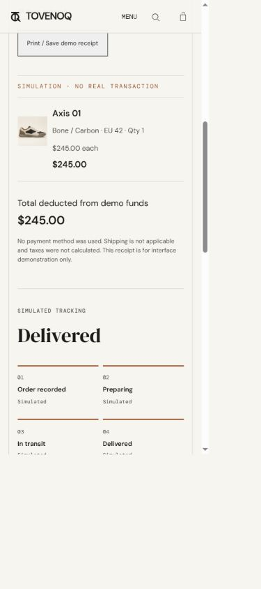

# Local responsive and keyboard verification

Recorded on 2026-09-29 against the built local export in one Codex in-app
Chromium browser. This is a bounded verification pass, not an accessibility
certification or a claim that every device/browser has been tested.

## Completed matrix

- **52 page-width checks:** each of the 13 page URLs below at 320, 390, 768
  and 1440px. Every check found one h1, no horizontal document overflow, and
  no broken completed images. This image check does not certify lazy images
  before they load. Viewport screenshots supplemented DOM measurements.
- **26 keyboard sweeps:** a full Tab cycle on each URL at 390 and 1440px.
  No focus entered inert/hidden controls; checked controls had visible outline
  styles. Product galleries and some linked controls scroll into view on focus.
- **33 gallery activations:** all five colourways' images selected with Enter
  at 390px; each had exactly one selected thumbnail and a loaded main image
  with the corresponding alt text. Axis colour change reset the gallery.
- **12 dialog-width checks:** search, Axis quick view and empty bag at all four
  widths. No document/panel horizontal overflow; opening focus was inside the
  panel. Populated bag interaction was separately tested at narrow phone width.
- **Receipt-width checks:** a populated local receipt at all four widths had
  no horizontal overflow or broken completed images.

| Page | Phone Tab stops (390px) | Desktop Tab stops (1440px) |
| --- | ---: | ---: |
| `/` | 37 | 44 |
| `/shop` | 37 | 44 |
| `/about` | 22 | 29 |
| `/help` | 21 | 28 |
| `/policies` | 21 | 28 |
| `/saved` (Axis saved) | 24 | 31 |
| `/account` (activity present) | 30 | 37 |
| `/checkout` (empty in sweep) | 22 | 29 |
| `/orders` (history present) | 22 | 29 |
| `/products/axis-01` | 57 | 64 |
| `/products/frame-02` | 57 | 64 |
| `/products/field-03` | 57 | 64 |
| `/products/line-04` | 57 | 64 |

Counts reflect the test browser's state, not a requirement that every visitor
have the same count. The export reports 14 prerendered routes; the matrix
above enumerates the 13 application page URLs tested.

## Interaction evidence and fixes

1. **Bag focus recovery:** Enter activated product options, size, quantity,
   save and Add to bag. Increasing quantity updated the subtotal. Removing the
   last line originally moved focus to body. `components/dialog.tsx` now watches
   panel mutations and focus entry, recovers to Close if the active control is
   removed/disabled, and handles Tab arriving from outside. Re-test: removing
   the last item focused Close; Shift+Tab wrapped to Explore footwear; Escape
   returned focus to the originating Quick view button. Search/quick view also
   wrapped first/last controls correctly and restored focus on Escape.
2. **Colour search:** typing Espresso originally returned zero despite the
   field advertising colour lookup. `lib/catalog.ts` now exposes `searchProducts`
   matching model/descriptor/copy and every colour name; the search component
   uses it and announces the result count through a polite status region.
   Re-test returned Axis 01; Enter/Tab wrapping still worked. The result card
   shows its default colour, not a promise of automatic variant selection.
   `tests/search.test.mjs` checks every current colourway, case/whitespace,
   model names, empty query and no-match behavior.
3. **Final tracking focus:** reaching Delivered originally disabled the
   active advance button and dropped focus to body. `app/orders/page.tsx` now
   moves focus to the new tracking heading only after the user's final advance;
   `app/globals.css` gives it an outline. Re-test focused the Delivered h3 with
   a solid outline, and the next Tab reached the footer home link normally.
   Loading/reopening a receipt does not automatically steal focus.

Additional checks: mobile menu expanded/collapsed via Enter/Escape at
320×568, with focus restored to Menu; a keyboard-activated New arrivals link
showed two styles; saved Axis appeared after navigation/reload; product
accordion, gallery, colour, size and quantity controls responded to keyboard
activation. Public content and narrow funding/product screens were visually
sampled. Full-page screenshot stitching was unreliable around scroll reveals
and fixed headers, so stitched captures were not used as proof of duplicate
content or as pixel-perfect certification.

The fictional journey used Enter to submit $1,000 custom funding, navigated
from bag to checkout, and placed a $245 Axis order. Insufficient-fund checkout
was disabled before funding. A second $245 order was created to re-test final
tracking after the fix. The first receipt and Delivered state survived reload.
These test funds/orders exist only in the local preview browser; no real charge,
shipment, external account or customer information was involved. No browser
storage was wiped. A representative on-screen receipt is shown below, not a
printed/PDF receipt verification.

## Final safe checks

- `npm test`: fresh export, 14 prerendered routes, 13 tests passed.
- `npm run lint`: exit 0, no errors, 12 existing raw-image warnings.
- `npx --no-install tsc --noEmit`: exit 0.
- Scoped whitespace checks: passed.

No new dependency, configuration, database, commit, push or deployment was
introduced by this pass. Application changes are limited to the three verified
interaction issues above. Original prompt documentation was not modified.

## Remaining outside this completed matrix

- Actual OS-enabled reduced-motion visual behavior.
- Actual printed/PDF receipt layout.
- Another browser engine and an actual spoken screen-reader session.
- Hosting, public-link/social crawler checks, commits and pushing (excluded).

The first three need tooling or user-side checks not available in this browser.
Image consistency across AI-generated angles and exclusive brand/logo rights
are not certified. See [progress](progress.md), [plan](plan.md),
[implementation log](implementation-log.md), [decisions](decisions.md),
[branding](branding.md) and [handover](../handover.md).
